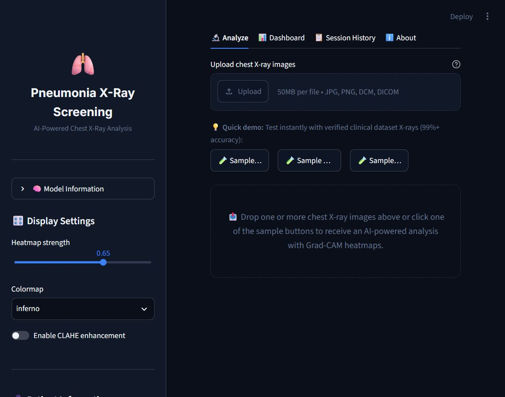
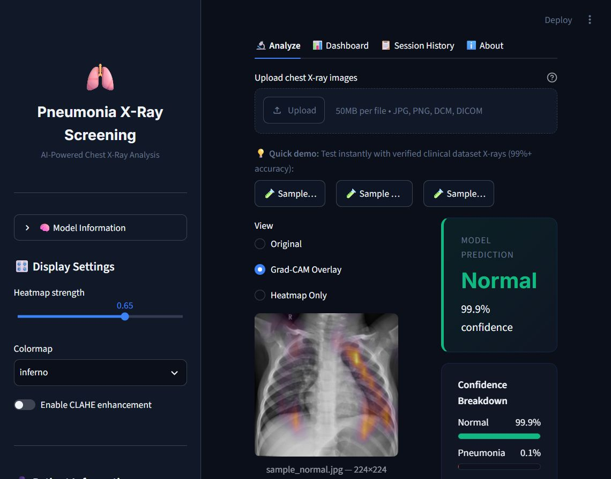
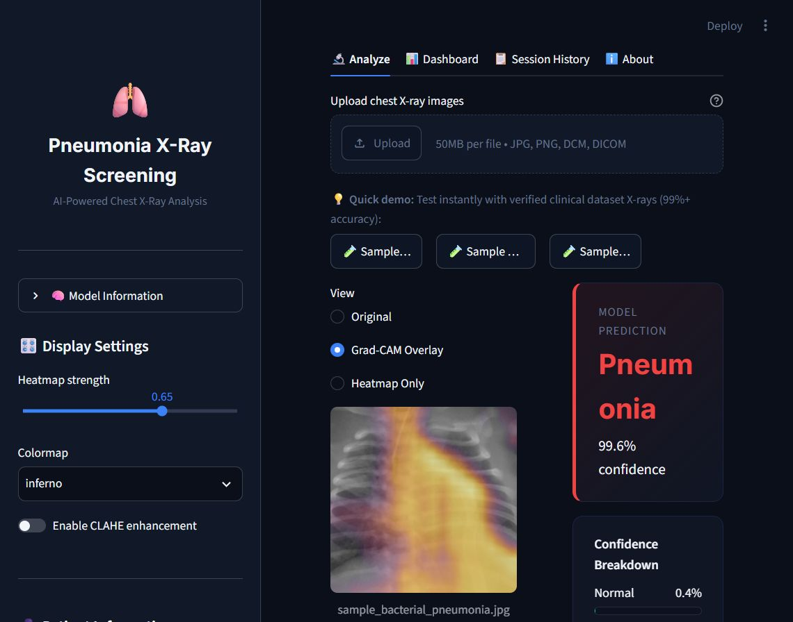
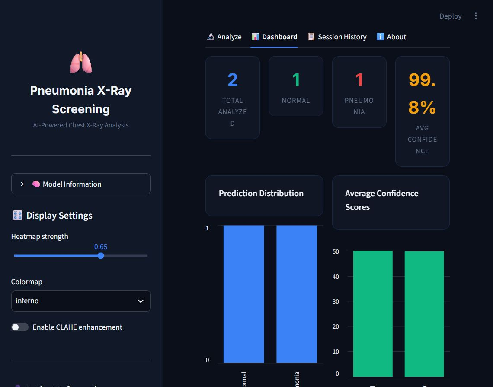
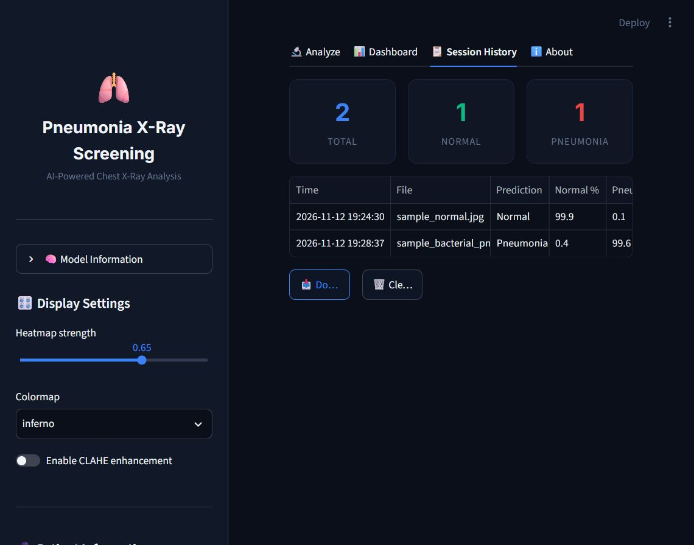
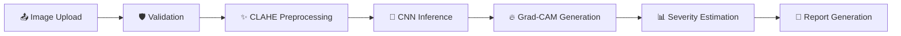

# 🫁 Pneumonia X-Ray Screening


**An AI-powered chest X-ray screening dashboard** that classifies chest X-rays as
**Normal** or **Pneumonia**, explains *why* with Grad-CAM heatmaps, estimates
**severity** with a regional lung breakdown, accepts standard images and native
**DICOM** files, and produces a professional **PDF report** — all in a single
Streamlit app that runs comfortably on CPU.

> [!CAUTION]
> **This is an AI-assisted preliminary screening tool, not a medical device.**
> It is not FDA-approved and must never replace a radiologist. A **"Normal"
> result does NOT rule out pneumonia** — on the held-out test set, 43 of 855
> pneumonia cases were misclassified as Normal. Always consult a qualified
> healthcare professional. See [Safety & Responsibility](#️-safety--responsibility).

---

## 📸 Screenshots

| Analyze tab — upload & one-click demo samples | Grad-CAM analysis of a healthy X-ray |
|:---:|:---:|
|  |  |

| Pneumonia verdict with severity assessment (59.3% affected, "Severe") | Analytics dashboard |
|:---:|:---:|
|  |  |

| Session history with CSV export |
|:---:|
|  |

---

## 🧠 Model & Performance

### Architecture

A custom lightweight CNN built from scratch in PyTorch — deliberately tiny so
that inference is real-time even on CPU-only deployments such as Streamlit Cloud:

| Property | Value |
|---|---|
| **Type** | 9-block convolutional network (alternating 3×3 and 1×1 convs) |
| **Parameters** | **11,486** (~11.5 K) |
| **Weights file size** | ~66 KB (`xray_model.pth`, shipped in this repo) |
| **Input** | 224 × 224 × 3 (RGB) |
| **Output** | 2 raw logits → `Normal` (0) / `Pneumonia` (1) |
| **Regularisation** | BatchNorm after every conv, 3× MaxPool2d, Global Average Pooling |
| **Final layer** | Conv2d 16→2 (4×4 kernel), no softmax (applied at inference) |
| **Grad-CAM target** | `convolution_block9` (last conv block) |

**How the architecture is organised:** the network follows a fire-module-inspired
design. Each **3×3 convolution** grows the receptive field (the region of the
image a neuron can "see"), while each **1×1 convolution** compresses the number
of channels, throwing away redundant features. Three 2×2 max-pooling stages
shrink the spatial resolution while the network builds up a semantic
understanding, and a final Global Average Pooling collapses the feature map into
a single decision vector. The result: the whole model is smaller than one layer
of ResNet, yet it reaches >95% accuracy on the pneumonia task — which is exactly
what makes one-second CPU inference and a 66 KB deployment possible.

### Weights

The weights shipped in this repository (`xray_model.pth`) are the final trained
weights used by the deployed app — no retraining is required to run it. Training
was performed offline on the public
[Chest X-Ray Images (Pneumonia)](https://www.kaggle.com/datasets/paultimothymooney/chest-xray-pneumonia)
dataset, and the trained model was then frozen and bundled with the app.

### Evaluation results (held-out test set)

The model was evaluated on a held-out test set of **1,172 chest X-ray images**
(317 Normal, 855 Pneumonia) that it never saw during training.

| Metric | Result | What it means |
|---|---|---|
| **Accuracy** | **95.14%** | 1,115 of 1,172 test images classified correctly overall |
| **Balanced accuracy** | **95.28%** | Average of both class recalls — stays honest under class imbalance |
| **Recall — Normal** | **95.6%** | 95.6% of actually-healthy X-rays correctly cleared |
| **Recall — Pneumonia** | **95.0%** | 95.0% of actually-sick X-rays correctly flagged |
| **Precision — Pneumonia** | **98.3%** | When the model *says* pneumonia, it is right 98.3% of the time |

**Confusion matrix (test set):**

| Actual \ Predicted | Predicted Normal | Predicted Pneumonia |
|---|---|---|
| **Actual Normal** (317) | ✅ **303** (TN) | 14 (FP) |
| **Actual Pneumonia** (855) | ⚠️ **43** (FN) | ✅ **812** (TP) |

#### How to read these numbers

- **Accuracy (95.14%)** answers "how often is the model right overall?" — but on
  an imbalanced test set (855 pneumonia vs 317 normal) a lazy model that always
  shouted "Pneumonia" would already score 73%. That is why **balanced accuracy
  (95.28%)** is reported alongside it: it averages the per-class recall rates,
  so both classes must be handled well for it to be high. Here it is virtually
  identical to plain accuracy, which confirms the model is **not** simply
  exploiting the class imbalance.
- **Pneumonia recall (95.0%)** is the most clinically important number: it is
  the probability that a sick patient is actually flagged. 812 of 855
  pneumonia cases were caught.
- **Pneumonia precision (98.3%)** means false alarms are rare — only 14
  healthy X-rays were wrongly flagged, so a positive prediction is highly
  reliable.
- **The 43 false negatives are the critical number.** These are pneumonia
  cases the model called Normal — missed cases. In screening, this is the most
  costly error type, and it is precisely why this project's messaging states
  everywhere (verdict card, PDF report, disclaimer) that a **Normal prediction
  must never be interpreted as proof that pneumonia is absent**. Early-stage,
  focal, or retro-cardiac opacities are exactly the cases that slip through.

> [!IMPORTANT]
> In a screening context, **false negatives are the most costly error** — a
> missed pneumonia case. The model/threshold should be tuned to prioritise
> pneumonia recall, and every image must still be reviewed by a radiologist
> regardless of the prediction.

### Dataset split & leakage

- **Test set:** 1,172 images (317 Normal / 855 Pneumonia) — held out from
  training, used only for the final evaluation above.
- The source Kaggle dataset ships images organised into
  `train / val / test` folders per class, and the evaluation above uses that
  held-out test organisation. *(TODO: fill in your exact train / validation
  image counts.)*
- **Leakage caveat:** chest X-rays from the *same patient* can appear multiple
  times in this dataset. A folder-based or random split may therefore place
  images from the same patient in both train and test, which would **inflate
  the reported accuracy**. For a fully trustworthy clinical estimate, a
  patient-wise (group) split on patient ID should be used — this is listed in
  [Future Work](#-future-work), and the numbers above should be read with this
  caveat in mind.

### Training setup

| Setting | Value |
|---|---|
| Loss | CrossEntropyLoss (softmax-based, matching the raw-logit output) |
| Optimizer / LR | *(TODO: e.g. Adam, lr, weight decay)* |
| Epochs | *(TODO)* |
| Class imbalance handling | *(TODO: weighted loss / oversampling / none)* |
| Augmentation | *(TODO: e.g. random flips, rotations, none)* |
| Hardware | *(TODO: CPU / GPU)* |

---

## ✨ Core Features

### 🔬 Prediction with confidence for both classes
Every image gets a softmax probability for **Normal** and **Pneumonia**
(displayed as animated confidence bars), plus a highlighted verdict card.
The probabilities are raw model outputs, not calibrated clinical probabilities
— a result near 50/50 signals low model confidence and the UI explicitly tells
you so.

### 🔥 Grad-CAM explainability
A hand-implemented
[Grad-CAM](https://arxiv.org/abs/1610.02391)
(gradient-weighted class activation mapping) answers the question *"where did
the model look?"*:

1. The predicted class score is backpropagated through the network.
2. The gradients flowing into the last conv block (`convolution_block9`)
   measure how much each feature channel contributed to the decision.
3. Each channel's spatial activation map is weighted by its average gradient,
   summed, and ReLU-clamped into a single 2D heatmap.
4. The heatmap is upsampled and blended over the original X-ray.

**Options:** a **heatmap strength slider** (0–1) controls overlay intensity,
and **4 colour maps** (inferno, viridis, magma, jet) are implemented in pure
NumPy — zero matplotlib dependency. Three views are available: **Original**,
**Grad-CAM Overlay**, and **Heatmap Only**.

> Grad-CAM shows where the model *focused* — it is an explanation of the model,
> **not** a definitive localisation of pathology.

### 📊 Severity estimation & regional breakdown
When pneumonia is predicted, the heatmap itself is analysed to estimate
disease extent:

- **Thresholding** — activations ≥ 0.4 are counted as "affected" pixels.
- **Affected-area percentage** — the share of the image above threshold, e.g.
  59.3% in the screenshot above.
- **5-zone regional breakdown** — Upper Left/Right, Lower Left/Right, and
  Central regions, each with its own affected percentage, rendered as a
  colour-coded grid (blue → amber → red as involvement grows).
- **Severity grade** — **Mild** (< 20%) · **Moderate** (20–50%) ·
  **Severe** (> 50%), each with an auto-generated clinical note describing the
  pattern and suggested follow-up.

> This is a heuristic *spatial* measure of the model's attention — not a
> radiological measurement of true disease extent, and not a clinical severity
> score.

### 🏥 Native DICOM support
`.dcm` files are detected by their `DICM` magic bytes, decoded with `pydicom`:

- **VOI LUT** (window/level) is applied when available, and
  `MONOCHROME1` polarity is auto-inverted, so the image looks correct.
- Metadata — patient name/ID/age/sex, study date, modality, body part, view
  position, institution — is displayed in an expander and merged into the PDF
  report (manually entered fields take precedence).

### 🛡️ Input validation & out-of-distribution rejection
Before inference, every upload passes through a validation pipeline:

- **Format decoding** — JPEG / PNG / DICOM, with clear inline error cards for
  empty, unreadable, or unsupported files.
- **Image quality checks** — blur (Laplacian variance < 40), under/overexposure
  (mean brightness outside 25–230), and low contrast (std < 15) are surfaced as
  warnings, since a blurry or overexposed X-ray can silently degrade the
  prediction.
- **Chest-X-ray plausibility heuristics** — minimum size (100×100), sane aspect
  ratio (≤ 2:1), grayscale dominance (low channel difference), and a bimodal
  intensity distribution typical of X-rays. Images that fail are flagged as
  *possibly not a chest X-ray* instead of silently producing a meaningless
  prediction — this is the out-of-distribution guard.

### ✨ CLAHE preprocessing (optional)
Contrast-Limited Adaptive Histogram Equalisation (OpenCV) enhances subtle
density differences in lung fields, with an adjustable **clip limit** (1–5).
It works even without OpenCV, thanks to a pure-PIL / pure-NumPy fallback path.

---

## 🔄 Workflow Features

- **Single or multi-image upload** — batch analyse several X-rays at once with
  a per-image selector and a **batch summary table** of every prediction.
- **One-click demo samples** — 5 verified X-rays from the clinical Kaggle
  dataset (healthy, bacterial, viral) ship inside the repo, so the app can be
  tested instantly on a fresh clone — no upload required.
- **Patient information fields** — Name, ID, Age, Sex, and Referring Physician
  entered in the sidebar are merged (with DICOM metadata) into the PDF report.
- **PDF diagnostic report** — one-click download containing: patient details,
  side-by-side original + Grad-CAM images, classification with confidence,
  severity grade and per-region table, clinical notes, and a mandatory
  disclaimer.
- **Analytics dashboard** — live totals, prediction distribution and average
  confidence bar charts, severity distribution, and a timestamped session
  timeline.
- **Session history + CSV export** — every prediction is logged for the
  session, viewable as a table and downloadable as CSV, with a two-step
  "are you sure" clear button.

---

## 🖥️ UI & User Experience

- **Dark medical-grade theme** with glass-morphism cards, an animated accent
  bar, and consistent colour semantics (green = Normal, red = Pneumonia,
  amber = Moderate).
- **Tab navigation** — Analyze · Dashboard · Session History · About — with a
  persistent sidebar for display settings and patient info.
- **Fast & lightweight** — the ~11.5 K-parameter model loads once via
  `st.cache_resource` and CPU inference is near-instant, so the app stays
  responsive across repeated analyses.
- **Robust error handling** — unreadable files, unsupported formats, and
  likely non-X-ray images produce friendly inline error/warning cards instead
  of stack traces; every utility module is feature-detected and degrades
  gracefully if missing.
- **Mobile** — Streamlit's responsive layout collapses the sidebar behind a
  toggle; the wide two-column analysis view is designed for desktop and
  tablet and remains usable (scrollable) on phones.

---

## 🧰 Code Quality & Engineering

```
pneumonia-xrayscreening/
├── streamlit_app.py          # Main Streamlit application (UI, inference, Grad-CAM)
├── arch.py                   # CNN architecture (torch.nn.Module)
├── xray_model.pth            # Trained weights (~66 KB)
├── requirements.txt          # Pinned deps incl. CPU-only PyTorch index
├── packages.txt              # System libs (libgl, libglib) for OpenCV on Linux
├── .streamlit/config.toml    # Dark theme + server configuration
├── docs/                     # Screenshots used by this README
├── sample_images/            # 5 verified demo X-rays
└── utils/
    ├── preprocessing.py      # CLAHE, quality assessment, full pipeline
    ├── dicom_handler.py      # DICOM detection, decoding, metadata
    ├── input_validator.py    # OOD heuristics + master validation
    ├── severity.py           # Heatmap → severity & regional analysis
    └── report_generator.py   # fpdf2 PDF report builder
```

- **Modular design** — inference, preprocessing, validation, severity, and
  reporting live in small focused modules; the main app wires them together.
- **Graceful degradation** — each `utils` import is feature-detected
  (`_HAS_*` flags), so the app still runs if a dependency is missing.
- **Runs from a fresh clone** — `pip install -r requirements.txt` +
  `streamlit run streamlit_app.py` is all it takes; weights and demo images
  are included.
- **Deployment-ready** — pre-configured for Streamlit Cloud (CPU PyTorch
  index in `requirements.txt`, system packages in `packages.txt`), with
  `.gitignore`, an MIT `LICENSE`, and committed app config.

---

## ⚙️ How It Works



1. **Validation** — format, quality, and X-ray plausibility checks.
2. **Preprocessing** — EXIF rotation, RGB conversion, optional CLAHE,
   resize → 224×224 centre crop, ImageNet normalisation.
3. **Inference** — forward pass produces 2 logits; softmax gives class
   probabilities.
4. **Grad-CAM** — the predicted-class gradient is backpropagated to the last
   conv block; channel activations are gradient-weighted, summed, and
   ReLU-clamped into a 2D attention map.
5. **Severity** — the heatmap is thresholded and split into 5 lung zones.
6. **Report** — everything is assembled into a downloadable PDF.

---

## 🚀 Getting Started

### Prerequisites
- Python 3.8+
- pip

### Quick start

```bash
git clone https://github.com/narayan8447/pneumonia-xrayscreening.git
cd pneumonia-xrayscreening

# CPU-only PyTorch by default (small download)
pip install -r requirements.txt

streamlit run streamlit_app.py
```

The app opens at `http://localhost:8501`. Click any of the **Sample** buttons
to see a full analysis in seconds — no uploads needed.

### GPU acceleration (optional)

```bash
pip install torch torchvision --index-url https://download.pytorch.org/whl/cu118
pip install -r requirements.txt
```

### Streamlit Cloud

1. Push the repository to GitHub.
2. On [share.streamlit.io](https://share.streamlit.io/), connect the repo and
   set the main file path to `streamlit_app.py`.
3. Deploy — everything (theme, system packages, CPU torch) is pre-configured.

---

## 🔭 Future Work

- **Patient-wise (group) data split** to eliminate the same-patient train/test
  leakage risk in the Kaggle dataset and report fully honest generalisation
  numbers.
- **Multi-class diagnosis** — bacterial vs viral vs fungal pneumonia, plus
  TB / COVID / lung-opacity classes.
- **Calibration & threshold tuning** — temperature scaling and a
  recall-prioritising decision threshold to shrink the 43-case false-negative
  count at the cost of a few more false alarms.
- **Lateral-view support** and smarter lung segmentation (e.g. U-Net) so
  severity maps follow true lung anatomy instead of an image grid.
- **Persistent, anonymised audit log** (opt-in) for longitudinal tracking.
- **Model upgrades** — transfer learning (DenseNet-121 / CheXNet-style) behind
  the same app interface.

---

## ⚠️ Safety & Responsibility

> [!CAUTION]
> **Not a medical device. Not FDA-approved. Not a diagnosis.**

- This tool produces AI-assisted *screening output* only. All results must be
  reviewed and confirmed by a qualified radiologist or physician.
- **A "Normal" prediction does NOT rule out pneumonia.** On the held-out test
  set, **43 of 855 pneumonia cases (5%) were misclassified as Normal.**
  Early, focal, or retro-cardiac opacities can be missed by the model or
  excluded by the 224×224 centre crop. Never use this output as the sole
  basis for a clinical decision.
- **Severity estimates are heuristic** — they describe the Grad-CAM heatmap's
  spatial spread, not true radiological extent or clinical severity.
- **Privacy on public deployments:** uploads are processed in memory and
  *not* stored server-side, but a public Streamlit Cloud instance must not be
  used with real patient data or PHI — DICOM files embed patient identifiers,
  and Streamlit Cloud does not provide a BAA or HIPAA-eligible processing
  environment. For real-world evaluation, deploy on infrastructure you
  control under your institution's data-governance policy.

---

## 📜 License

This project is licensed under the **MIT License** — see the
[LICENSE](LICENSE) file for details.

## 👥 Author

- **Narayan** — [GitHub](https://github.com/narayan8447)

---

<p align="center">
  Made with ❤️ for accessible healthcare AI
</p>
